<p align="right">
  <sub>🇺🇸 <strong>English</strong> · <a href="./README.pt-br.md">🇧🇷 Português</a></sub>
</p>

<p align="center">
  
</p>

<p align="center">
  <sub>TypeScript · Python · JavaScript · React · Streamlit · Pandas · Linux · Cybersecurity · Git</sub>
</p>

---

Hi, I'm **Manuel Ferreira** (`@quilty0`).

I build web applications, smartwatch monitoring solutions, and interactive data dashboards—while diving deeper into **cybersecurity**, networking, and automation. Most of my projects start from practical, real-world problems: turning raw datasets into clear visualizations with Python and Streamlit, or crafting clean interfaces with TypeScript and React.

I care about clean code, security-minded engineering, and tools that are straightforward to use and maintain.

### `~/now`

```json
{
  "building": ["web apps in TypeScript", "Python data dashboards", "automation workflows"],
  "exploring": ["cybersecurity fundamentals", "networking & Linux hardening", "security tooling"],
  "status": "learning in public & shipping practical projects"
}
```

### `~/projects`

<table>
  <tr>
    <td width="50%" valign="top">
      <a href="https://github.com/quilty0/analise-dados-jogos"><strong>analise-dados-jogos</strong></a><br/>
      Interactive game sales data analysis dashboard by genre built with Python and Streamlit.<br/>
      <sub><code>Python</code> · <code>Streamlit</code> · <code>Pandas</code></sub>
    </td>
    <td width="50%" valign="top">
      <a href="https://github.com/quilty0/guardiao-atento"><strong>guardiao-atento</strong></a><br/>
      Elderly patient monitoring web platform focused on real-time care and alerts.<br/>
      <sub><code>TypeScript</code> · <code>Web App</code></sub>
    </td>
  </tr>
  <tr>
    <td width="50%" valign="top">
      <a href="https://github.com/quilty0/guardiao-atento-watch"><strong>guardiao-atento-watch</strong></a><br/>
      Companion smartwatch monitoring application for the Guardião Atento ecosystem.<br/>
      <sub><code>TypeScript</code> · <code>Wearables</code></sub>
    </td>
    <td width="50%" valign="top">
      <a href="https://github.com/quilty0/Barbercare"><strong>Barbercare</strong></a><br/>
      Web application for barbershop management, scheduling, and customer service.<br/>
      <sub><code>TypeScript</code> · <code>Frontend</code></sub>
    </td>
  </tr>
  <tr>
    <td width="50%" valign="top">
      <a href="https://github.com/quilty0/analise-dados-alunos"><strong>analise-dados-alunos</strong></a><br/>
      Exploratory data analysis of student performance metrics and trends.<br/>
      <sub><code>Python</code> · <code>Data Analysis</code></sub>
    </td>
    <td width="50%" valign="top">
      <a href="https://github.com/quilty0/portfolio"><strong>portfolio</strong></a><br/>
      Personal developer portfolio built with a focus on clean layout and responsiveness.<br/>
      <sub><code>HTML5</code> · <code>CSS3</code> · <code>JavaScript</code></sub>
    </td>
  </tr>
</table>

### `~/stack`

- **Languages:** TypeScript, Python, JavaScript, HTML5, CSS3
- **Frontend & UI:** React, Tailwind CSS, Responsive Design
- **Data & Dashboards:** Streamlit, Pandas, Data Visualization
- **Security & Workflow:** Linux, Networking fundamentals, Git, GitHub, VS Code

<div align="center">
  <picture>
    <source media="(prefers-color-scheme: dark)" srcset="https://skillicons.dev/icons?i=ts,py,js,react,html,css,tailwind,nodejs,linux,git,github,vscode&theme=dark&perline=12" />
    <source media="(prefers-color-scheme: light)" srcset="https://skillicons.dev/icons?i=ts,py,js,react,html,css,tailwind,nodejs,linux,git,github,vscode&theme=light&perline=12" />
    
  </picture>
</div>

<p align="center">
  
  
  
  
  
  <br/>
  
  
  
  
  
  
</p>

### `~/activity`

<div align="center">
  <picture>
    <source media="(prefers-color-scheme: dark)" srcset="https://raw.githubusercontent.com/quilty0/quilty0/output/github-snake-dark.svg" />
    <source media="(prefers-color-scheme: light)" srcset="https://raw.githubusercontent.com/quilty0/quilty0/output/github-snake.svg" />
    
  </picture>
</div>

### `~/stats`

<div align="center">
  <picture>
    <source media="(prefers-color-scheme: dark)" srcset="https://github-readme-stats.vercel.app/api?username=quilty0&show_icons=true&include_all_commits=true&count_private=true&title_color=00e5a0&icon_color=38bdf8&text_color=e6edf3&bg_color=0b0f14&hide_border=true" />
    <source media="(prefers-color-scheme: light)" srcset="https://github-readme-stats.vercel.app/api?username=quilty0&show_icons=true&include_all_commits=true&count_private=true&title_color=0d1117&icon_color=0284c7&text_color=0d1117&bg_color=transparent&hide_border=true" />
    
  </picture>
  <picture>
    <source media="(prefers-color-scheme: dark)" srcset="https://github-readme-stats.vercel.app/api/top-langs?username=quilty0&layout=compact&langs_count=6&title_color=00e5a0&text_color=e6edf3&bg_color=0b0f14&hide_border=true" />
    <source media="(prefers-color-scheme: light)" srcset="https://github-readme-stats.vercel.app/api/top-langs?username=quilty0&layout=compact&langs_count=6&title_color=0d1117&text_color=0d1117&bg_color=transparent&hide_border=true" />
    
  </picture>
</div>

<div align="center">
  <picture>
    <source media="(prefers-color-scheme: dark)" srcset="https://streak-stats.demolab.com/?user=quilty0&theme=dark&background=0b0f14&border=00000000&ring=00e5a0&fire=38bdf8&currStreakNum=e6edf3&sideNums=e6edf3&currStreakLabel=00e5a0&sideLabels=00e5a0&dates=6b7683" />
    <source media="(prefers-color-scheme: light)" srcset="https://streak-stats.demolab.com/?user=quilty0&theme=default&background=transparent&border=00000000&ring=00a876&fire=0284c7" />
    
  </picture>
</div>

<br/>

<p align="center">
  <a href="https://github.com/quilty0"></a>
  <a href="https://github.com/quilty0/portfolio"></a>
</p>
