  

  TypeScript · Python · JavaScript · Streamlit · React · HTML5 · CSS3 · Git

 

Hi, I'm **Manuel Ferreira** ( `@quilty0` ).

I build web applications, smartwatch/monitoring solutions, and data analysis dashboards. Most of my projects start from real-world problems—turning data into clear visualizations with Python and Streamlit, or crafting responsive interfaces with TypeScript and JavaScript.

I care about clean code, practical tools, and software that is straightforward to use and maintain.

### ~/projects

- [analise-dados-jogos](https://github.com/quilty0/analise-dados-jogos) — análise de dados de vendas de jogos por gênero com painel interativo · `Python` · `Streamlit`
- [guardiao-atento](https://github.com/quilty0/guardiao-atento) — sistema de monitoramento de pacientes idosos · `TypeScript`
- [guardiao-atento-watch](https://github.com/quilty0/guardiao-atento-watch) — aplicativo de monitoramento para smartwatch · `TypeScript`
- [Barbercare](https://github.com/quilty0/Barbercare) — aplicação web para gestão e atendimento em barbearia · `TypeScript`
- [analise-dados-alunos](https://github.com/quilty0/analise-dados-alunos) — exploração e análise de dados de desempenho estudantil · `Python`
- [portfolio](https://github.com/quilty0/portfolio) — portfólio profissional desenvolvido com foco em layout e responsividade · `HTML` · `CSS` · `JavaScript`

### ~/stack

- **Languages:** TypeScript, Python, JavaScript, HTML5, CSS3
- **Data & Dashboards:** Streamlit, Pandas, Data Visualization
- **Frontend & UI:** React, Responsive Design, Tailwind CSS
- **Tools & Workflow:** Git, GitHub, VS Code

  
  
  
  
  
  
  
  

### ~/stats

  
  

  

 

  

